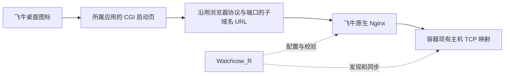

# Watchcow_R

将 Docker Web 应用添加到飞牛 fnOS 桌面，通过容器名子域名复用飞牛现有 HTTP/HTTPS 端口。

例如，打开飞牛 `http://nas.example.com:5666` 后，点击 EmbyServer 图标将访问：

```text
http://embyserver.nas.example.com:5666/
```

从 `https://nas.example.com:5667` 进入，则使用 `https://embyserver.nas.example.com:5667`。后端仍可运行 HTTP 8096。无需为每个应用额外放行公网端口。

基于 [tf4fun/watchcow](https://github.com/tf4fun/watchcow)，保留上游 MIT 许可证；上游说明见 [README.upstream.md](README.upstream.md)。这是独立应用，显示名 **Watchcow_R**，包名 **watchcow-r**。生成的子应用沿用 `watchcow.*` 或原有自定义标识。

## 安装

1. 为 `*.nas.example.com` 设置 DNS，指向原 NAS 域名或同一公网 IP。IPv4、IPv6 按实际网络配置；不需要向本应用提供 DNS 密钥。
2. 从 Releases 下载 `Watchcow_R-x86.fpk` 或 `Watchcow_R-arm.fpk`，在飞牛应用中心手动安装。
3. 安装向导填入基础域名，例如 `nas.example.com`，不含协议、端口和 `*`。默认扩展授权为 `false`，安装后先显示说明页，不接管旧 WatchCow、不修改 Nginx。
4. 阅读扩展模式说明后，在应用配置中将 `WATCHCOW_R_NATIVE_EXTENSIONS` 设置为 `true`，才开始迁移。飞牛 Web 服务将重启一次，已有网页/WebSocket 连接可能中断；Docker 业务容器不重启。扩展期间暂停飞牛 Nginx 的配置自恢复。
5. 启动 Watchcow_R，打开桌面上的管理员控制面板，进入「反向代理设置」查看入口、后端、DNS、证书及应用错误。
6. 等待首次同步完成后刷新飞牛桌面。新建或修改应用后，反代入口通常在下一次 5 秒同步时更新。

HTTPS 证书必须覆盖实际子域名，例如 `*.nas.example.com`。请通过飞牛原有证书管理配置和续期；只覆盖 `nas.example.com` 的证书不能用于 `embyserver.nas.example.com`。Watchcow_R 不复制私钥、不签发证书、不改变系统端口，也不会把 HTTPS 自动降级为 HTTP。

浏览器当前访问端口必须已经指向飞牛 Nginx。通过额外外部网关转发时，需要让该网关同时接受这些子域名。仅配置 DNS 不会改变公网 IP、防火墙、端口转发或带宽。

## 扩展模式兼容性

当前飞牛 Nginx 会在每次正常重载时恢复自带配置，清除自定义主配置 include 和 `conf.d` 文件。因此不能直接套用普通 Nginx 的配置方式。Watchcow_R 在明确授权后增加唯一的 systemd drop-in：

```ini
# /etc/systemd/system/trim_nginx.service.d/watchcow-r.conf
[Service]
Environment=NGXMODE=dev
```

它保留飞牛原生二进制、监听端口和证书模块，并使用其已有的 `conf.d` 扩展按 Host 分流，但会暂停该模块的文件自恢复/监视。安装选项默认关闭。停止本应用只将反代域名设为 503；卸载才移除这个自有 drop-in，并重启 Web 服务恢复先前模式。若接管后其他 Nginx 配置发生变更，自动恢复会停止并报告，避免正常模式的自恢复清除其他修改。已经由用户启用扩展模式的系统不会添加或移除用户的设置。

这是首个测试版本，尚未完成真实 FPK 安装/卸载及外网账户验收。请先在测试设备或维护窗口验证。

## 现有 WatchCow 迁移

首次启动先验证已支持的飞牛 Nginx 布局，记录原 WatchCow 的运行状态，停止旧守护程序，再备份并接管其桌面入口。实际业务容器不停止、不重建，也不修改 Compose。

- 保留子应用标识、标题、图标、显示权限和其他桌面字段。
- 导入原控制面板配置及能识别的 WatchCow 生成应用，包括当前停止的容器。
- 完整生成包备份、原桌面文件、旧配置及 Nginx 原文件保存在 `/var/apps/watchcow-r/etc/backup/`。
- 运行期间检测到旧 WatchCow 再次启动，会停止继续应用配置并提示冲突。请勿同时运行两个守护程序。
- 停止 Watchcow_R 后，已有反代域名返回 503；业务容器保持原状态。
- 停止并卸载 Watchcow_R 时，会移除自有 Nginx 扩展配置、恢复原入口及旧 WatchCow 原运行状态。若文件在接管后被其他程序修改，会保留修改并报告冲突，避免覆盖。

需要手工回退时，先停止 Watchcow_R，再执行：

```bash
TRIM_PKGETC=/var/apps/watchcow-r/etc \
  /var/apps/watchcow-r/target/watchcow-r --mode rollback
```

首次安装前建议保留系统/应用数据快照和额外备份。应用自己的备份用于恢复它修改的配置，不替代整个 NAS 的备份。

## 容器标签与地址

兼容原 `watchcow.*` 配置，例如：

```yaml
services:
  emby:
    container_name: EmbyServer
    ports:
      - '8096:8096'
    labels:
      watchcow.enable: 'true'
      watchcow.display_name: 'Emby Server'
      watchcow.service_port: '8096' # 映射后的 NAS 主机 TCP 端口
      watchcow.protocol: 'http'  # 后端协议，独立于浏览器的 HTTP/HTTPS
      watchcow.proxy.enable: 'true'
      # 可选，覆盖自动生成的 embyserver
      watchcow.proxy.subdomain: 'emby'
```

多入口：

```yaml
labels:
  watchcow.enable: 'true'
  watchcow.web.service_port: '8080'
  watchcow.web.proxy.subdomain: 'myweb'
  watchcow.admin.service_port: '8081'
  watchcow.admin.proxy.enable: 'false'
```

默认地址来自 Docker 容器名；命名入口增加入口名，如 `container-admin.nas.example.com`。名称会转小写、规范化为 DNS 标签，冲突时分配稳定哈希后缀。分配表按容器名和入口持久化，容器重新创建、镜像升级不会因为容器 ID 变化而换地址。已分配的名字保持保留，手工指定重复名字会报错。

控制面板可单独设置入口反代开关和子域名，无需修改容器标签；面板覆盖值优先于标签。`false` 恢复该入口原来的直接访问方式。外部 `watchcow.redirect` 入口保留原跳转逻辑。非 HTTP/HTTPS、常见数据库端口和未通过 HTTP 响应检测的服务不会自动接管。停止的容器保留 503 入口，启动后重新检测。

## 工作方式



视频、下载、上传和 WebSocket 直接经过原生 Nginx，不经过 Go 管理服务。转发保留 Host、原始查询和请求体，关闭请求/响应缓冲，支持 Range 与 Upgrade。后端 HTTPS 支持本机自签名服务；与 Nginx 默认行为一致，未开启后端证书信任链校验。

管理服务只监听 Unix socket。根应用入口仅管理员可见；对所有用户可见的子应用 CGI 只接受属于该应用的启动/跳转路由，不能转发管理 API。代理应用使用各自的登录认证，桌面图标可见性不等于服务端访问控制。

Nginx 通过现有 server 级 `conf.d/watchcow-r.conf` 扩展按域名分流，不增加 default_server 或公网端口，不改变主配置。应用路径在 location 匹配前分流，因此 `/websocket` 等路径也会进入所属应用。根域名继续访问飞牛。写入采用文件锁、持久事务、原文件备份、校验、重载后的实际配置版本探测及失败恢复。校验/信号命令使用模块 debug 环境；长期运行的主进程使用前述明确授权的扩展模式。未知模块或布局会报错停止。飞牛更新后仍需重新验证兼容性。

## 构建与验证

需要 Go 1.25、Linux、飞牛官方 `fnpack`。GitHub Actions 执行竞态测试并生成 x86/ARM64 FPK，版本标签可构建 Release。

```bash
go test -race ./...
go vet ./...
CGO_ENABLED=0 GOOS=linux GOARCH=amd64 go build -trimpath -ldflags '-s -w' \
  -o fnos-app/app/watchcow-r ./cmd/watchcow
chmod +x fnos-app/cmd/* fnos-app/app/watchcow-r
(cd fnos-app && fnpack build)
```

ARM64 使用 `GOARCH=arm64`、manifest `platform=arm` 并移除 `arch=x86_64`。

原生飞牛 Nginx 集成测试在专门的挂载、网络和 PID 命名空间运行，同时隔离 Nginx 全目录、Web 目录与 `/run`，不会使用线上端口或原配置。必须在飞牛以 root 运行，先编译测试二进制到任务目录：

```bash
mkdir -p /root/.work/watchcow-r-test/native
go test -c -o /root/.work/watchcow-r-test/native/reverse.test ./internal/reverse
bash scripts/test-fnos-native.sh /root/.work/watchcow-r-test/native
```

自动测试覆盖命名/冲突/重建、路由校验、事务与崩溃恢复、迁移和外部修改保护、CGI 权限边界、浏览器协议/端口继承，以及隔离环境中的 HTTP/HTTPS、IPv4/IPv6、Range、流式上传和双向 Upgrade。真实 Emby 登录、媒体兼容、外网 DNS/证书与性能仍需在安装后以实际账户和网络验收。ARM64 提供交叉编译包，尚需 ARM 飞牛设备验收。
